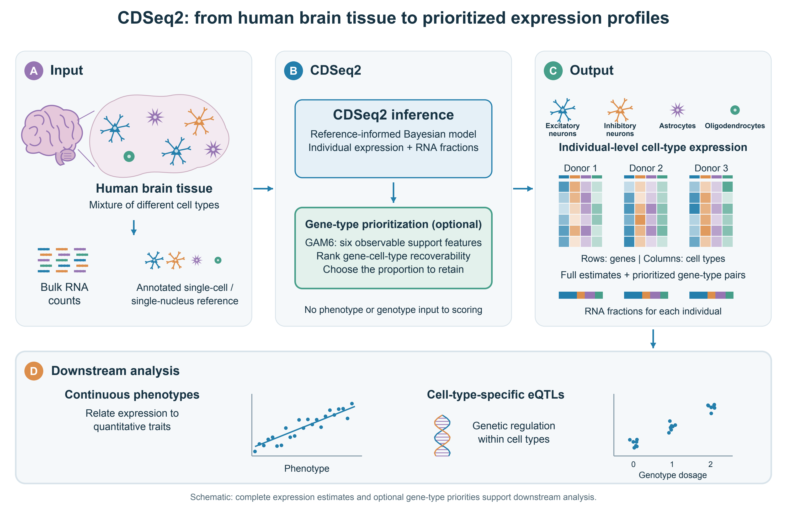
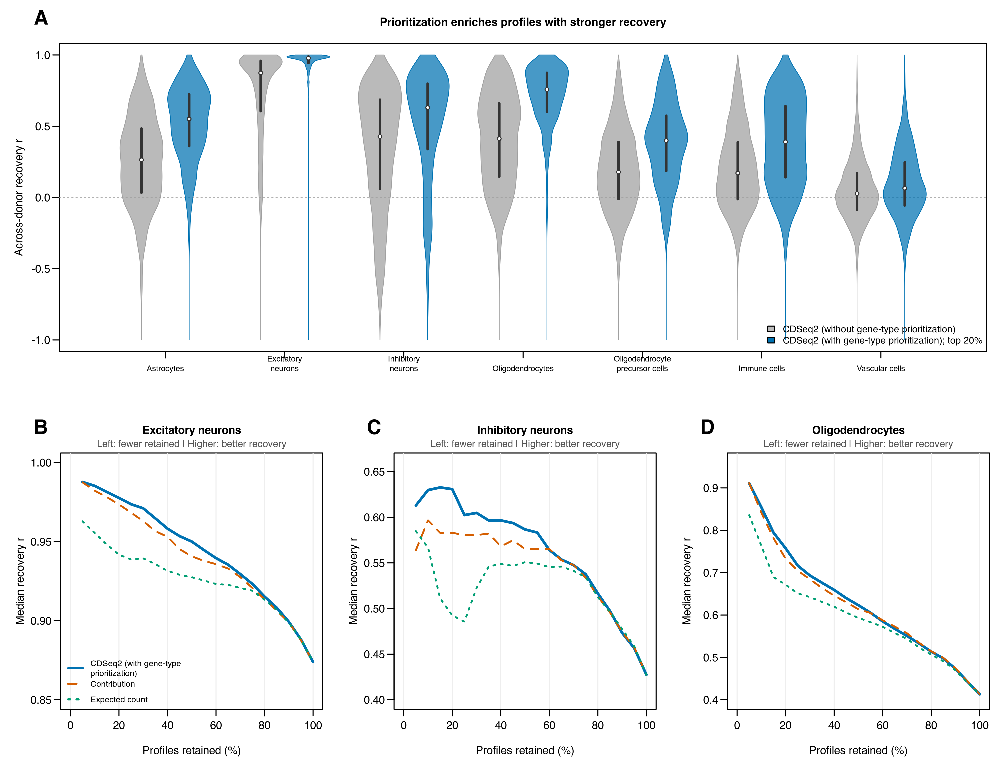
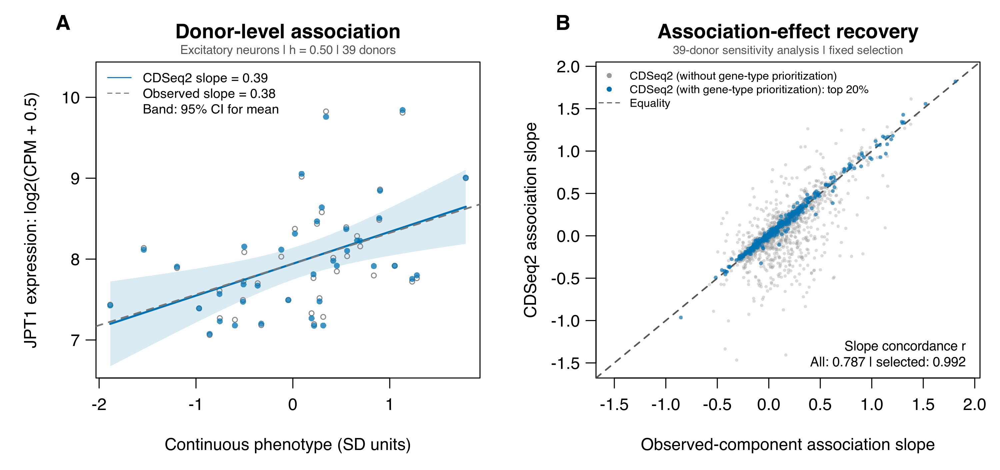
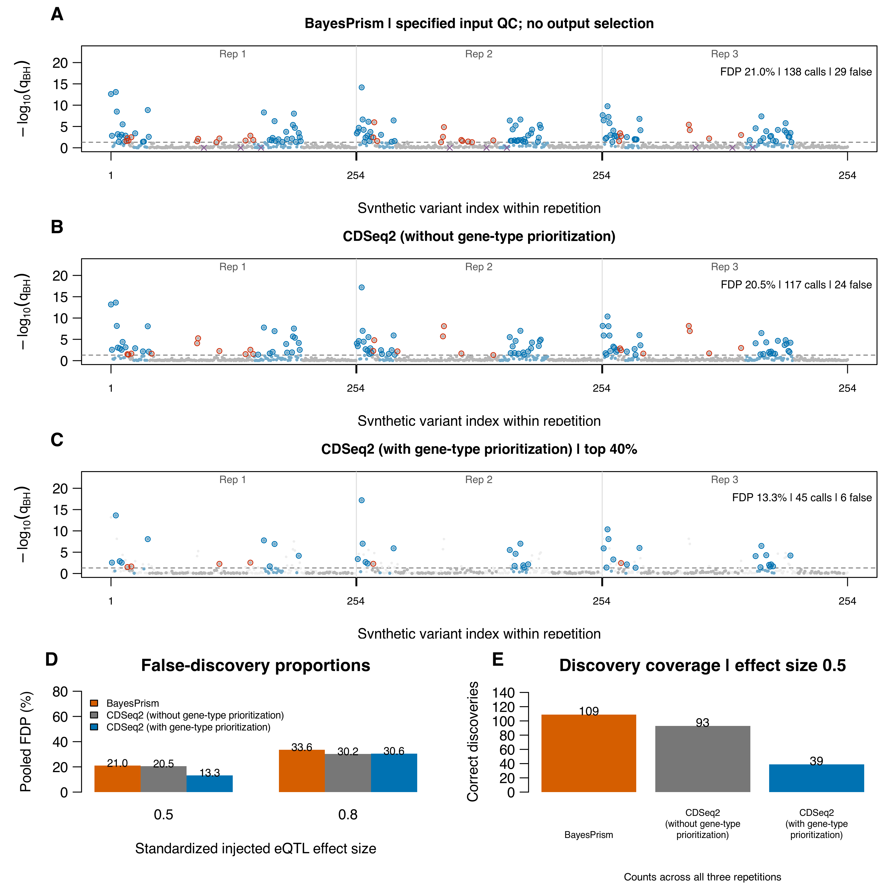
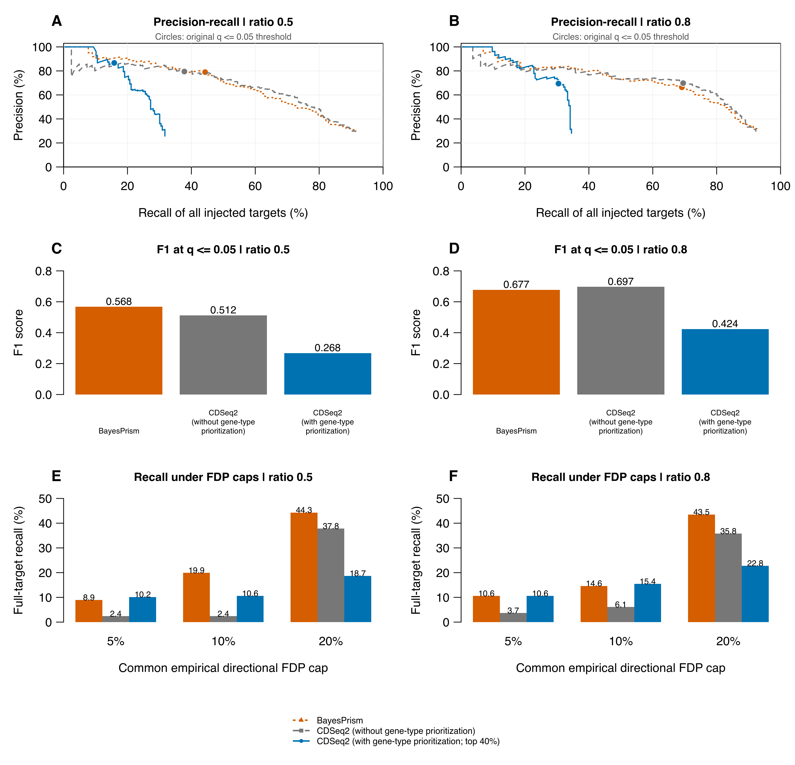
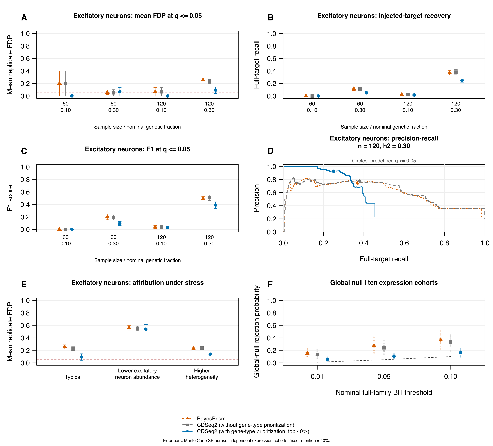
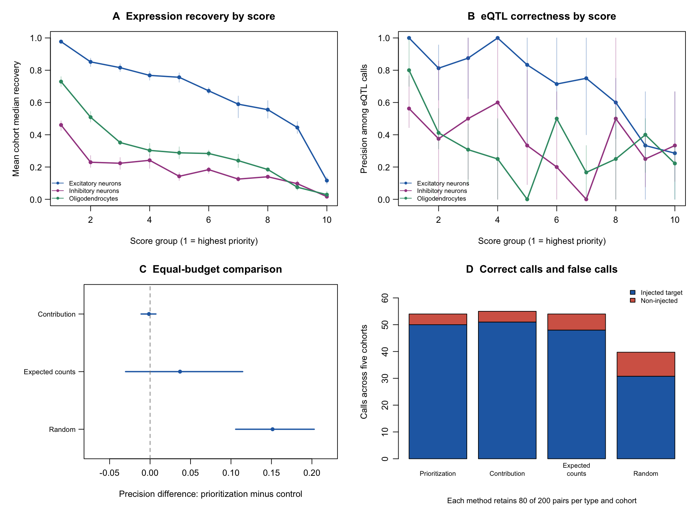

# Main figures

All seven main figures and captions match manuscript version 16. [Download the manuscript](../downloads/manuscript.pdf) or [underlying tables](data.qmd).

## Figure 1 {#figure-1}

{fig-alt="Figure 1; detailed caption follows." loading="lazy"}

**Input, CDSeq2 (with gene-type prioritization) and output for individual-level expression analysis.** (A) Human brain tissue contains multiple cell types. Short reads colored by their schematic cell-type origins represent bulk RNA; the annotated reference reuses the neuron and glial shapes shown in the tissue and output. Bulk RNA counts from individual donors and an annotated single-cell or single-nucleus reference provide complementary inputs. (B) Reference-informed CDSeq2 inference estimates individual-level expression and RNA fractions; optional GAM6 scoring uses six observable support features to rank gene/type profiles by predicted across-donor recoverability. No phenotype or genotype is supplied to the scorer. (C) Each donor has a gene-by-cell-type expression matrix. Column colors match the illustrated cell types consistently across tissue, cell icons, expression matrices and RNA-fraction bars; within-column shading is illustrative expression intensity. Complete estimates and optional prioritized gene/type pairs are available without refitting inference. (D) Downstream continuous-phenotype and eQTL analyses assess association accuracy together with discovery coverage. Cartoons and mini-plots are schematic, not measured data. Model development and evaluation are described in Supplementary Section 1.6. Visualization code was prepared with OpenAI Codex assistance. Underlying data are provided in Supplementary Tables S1, S12 and S16--S18 for the illustrated benchmark evaluations.

**Table links:** [S1](data.qmd#s1), [S12](data.qmd#s12), [S16](data.qmd#s16), [S17](data.qmd#s17), [S18](data.qmd#s18).

## Figure 2 {#figure-2}

{fig-alt="Figure 2; detailed caption follows." loading="lazy"}

**CDSeq2 (with gene-type prioritization) prioritizes more accurately recovered expression profiles.** (A) Paired violins compare CDSeq2 (without gene-type prioritization) across all evaluable profiles (gray) with CDSeq2 (with gene-type prioritization) retaining the top 20% in each cell type (blue). The upward shift of the blue distributions indicates enrichment for profiles that more accurately preserve donor-to-donor expression variation. It reflects selection of existing estimates, not a refit or a change to each estimate. White points mark medians and thick lines mark interquartile ranges; equal maximum widths show density, not sample size. There are 2,000 candidate genes and 400 selected genes per type; undefined correlations are omitted. (B--D) Median recovery versus retention for excitatory neurons, inhibitory neurons and oligodendrocytes compares CDSeq2 (with gene-type prioritization) with contribution and expected-count rankings. Moving left retains fewer profiles; a higher curve at the same retention indicates more effective prioritization. At 100% retention, all profiles are retained. Panels use different expanded vertical scales to show differences; Supplementary Fig. S1 provides a common scale. Results use 40 evaluation donors; model development and complete cell-type performance are described in Supplementary Section 1.6. Visualization code was prepared with OpenAI Codex assistance. Underlying data are provided in Supplementary Tables S1, S2 and S11.

**Table links:** [S1](data.qmd#s1), [S2](data.qmd#s2), [S11](data.qmd#s11).

## Figure 3 {#figure-3}

{fig-alt="Figure 3; detailed caption follows." loading="lazy"}

**Individual-level continuous-phenotype association recovery.** Both panels show the 39-donor sensitivity analysis of the first excitatory-neuron expression program at signal fraction 0.50 and noise repetition 1, archived as `trait_031`. (A) JPT1 expression versus phenotype: blue points and a solid line show CDSeq2 estimates and their regression; open gray points and a dashed line show observed components. The blue band is a pointwise 95% confidence interval for the fitted mean, conditional on estimated expression. JPT1 was chosen by its highest frozen GAM6 score among the program genes, independently of association fit. (B) Estimated versus observed-component association slopes for all 2,000 excitatory-neuron genes (gray), with the fixed top-20% prioritized subset highlighted in blue. The dashed diagonal marks equality; slope concordance is 0.787 overall and 0.992 among prioritized profiles. Phenotype units retain the original 40-donor standardization. Expression inference and scoring are unchanged. Cohort selection and influence diagnostics are detailed in Supplementary Section 3.5; Table S25 contains the full 40-donor result and every single-donor omission. Observed-component slopes are empirical reference estimates. Visualization code was prepared with OpenAI Codex assistance. Underlying data are provided in Supplementary Tables S16, S17 and S25.

**Table links:** [S16](data.qmd#s16), [S17](data.qmd#s17), [S25](data.qmd#s25).

## Figure 4 {#figure-4}

{fig-alt="Figure 4; detailed caption follows." loading="lazy"}

**Three-workflow comparison of eQTL inference and added prioritization in excitatory neurons.** Signal ratio is 0.5. Indexed Manhattan-style panels show (A) standard BayesPrism with the specified native input preprocessing, (B) CDSeq2 (without gene-type prioritization) and (C) CDSeq2 (with gene-type prioritization) top-40% selection. A and B have no output reliability selection; C retains the same CDSeq2 estimates and association statistics as B. Each panel concatenates three repetitions in the same variant order. Blue filled points indicate injected excitatory-neuron tests and gray points indicate non-injected tests. Blue outlines mark correct-sign significant calls; red outlines mark false or wrong-sign calls. In C, discarded tests are faint background points without call outlines. In A, purple baseline crosses mark preprocessing-excluded genes. The dashed line is BH-adjusted $q=0.05$ using the original 1,778-test family. (D) Pooled FDP at both signal ratios. (E) Correct discoveries at 0.5 show the coverage cost of prioritization. CDSeq2 (with gene-type prioritization) retains 101 pairs per repetition; BayesPrism tests all 251 genes surviving input QC at ratio 0.5. Repetitions reuse 40 donors, variants lack genomic coordinates, and observed FDP does not establish nominal FDR control. The 0.8 comparison is in Fig. S8. Visualization code was prepared with OpenAI Codex assistance. Underlying data are provided in Supplementary Tables S6, S18 and S19.

**Table links:** [S6](data.qmd#s6), [S18](data.qmd#s18), [S19](data.qmd#s19).

## Figure 5 {#figure-5}

{fig-alt="Figure 5; detailed caption follows." loading="lazy"}

**Gene-type prioritization supports precise eQTL discovery in excitatory neurons.** Columns show signal ratios 0.5 and 0.8. Orange, gray and blue denote standard BayesPrism, CDSeq2 (without gene-type prioritization) and CDSeq2 (with gene-type prioritization) with fixed top-40% selection. BayesPrism uses the specified native input preprocessing; only CDSeq2 (with gene-type prioritization) applies output reliability selection. (A,B) Precision--recall curves sweep original BH-adjusted thresholds; circles mark $q\leq0.05$. All tests tied at a threshold enter together; connecting lines guide the eye and do not imply additional attainable operating points. (C,D) F1 at $q\leq0.05$ combines precision and full-target recall. (E,F) Maximum recall under common empirical directional FDP caps of 5%, 10% and 20% assesses discovery coverage at a shared error budget. Correct calls require the injected target and sign; all other calls contribute to FDP. Recall uses all 246 injected excitatory-neuron targets, including discarded or unavailable targets. Counts pool three repetitions using the same 40 donors. GAM6 membership stays fixed. Matched-cap thresholds use truth retrospectively and may exceed 0.05; achieved FDP can fall below the cap. This is not a prospective FDR-control procedure. Repetition-specific curves are in Fig. S10. Visualization code was prepared with OpenAI Codex assistance. Underlying data are provided in Supplementary Tables S20, S21 and S22.

**Table links:** [S20](data.qmd#s20), [S21](data.qmd#s21), [S22](data.qmd#s22).

## Figure 6 {#figure-6}

{fig-alt="Figure 6; detailed caption follows." loading="lazy"}

**Frozen-rule evaluation in independent synthetic cohorts with local LD.** Standard BayesPrism (orange), CDSeq2 (without gene-type prioritization; gray) and CDSeq2 (with gene-type prioritization; blue) use fresh inference in every cohort. The scorer and top-40% rule were fixed before test generation; BayesPrism uses native preprocessing without output selection. Each signal setting has five independent cohorts. (A--C) Mean replicate FDP, full-target recall and F1 for excitatory neurons at $q\leq0.05$, across sample sizes 60 and 120 and nominal pre-normalization genetic variance fractions $h^2=0.10$ and 0.30. Error bars are Monte Carlo standard errors. (D) Precision--recall curves pool the five $n=120$, $h^2=0.30$ cohorts at common gene-level $p$ thresholds. Circles mark $q=0.05$, which need not map to one pooled raw-$p$ threshold. (E) Mean excitatory-neuron FDP under typical abundance, lower excitatory-neuron abundance and higher heterogeneity at $n=120$, $h^2=0.30$. Dashed lines in A and E mark 0.05, not guaranteed control. (F) Global-null probability of any full-family rejection at three nominal thresholds: 100 genotype realizations in each of ten independent 60-individual expression cohorts. Error bars use between-cohort standard errors; the dashed line gives nominal thresholds. Discovery denotes a directly injected gene/type effect, not the causal SNP. FDP measures direct-target attribution; normalization-induced marginal effects can fall outside the injected set. All workflows retain the 1,400-pair testing and full-target truth denominators; prioritization retains 80 of 200 candidate profiles per type. Visualization code was prepared with OpenAI Codex assistance. Underlying data are provided in Supplementary Tables S26--S31 and S35.

**Table links:** [S26](data.qmd#s26), [S27](data.qmd#s27), [S28](data.qmd#s28), [S29](data.qmd#s29), [S30](data.qmd#s30), [S31](data.qmd#s31), [S35](data.qmd#s35).

## Figure 7 {#figure-7}

{fig-alt="Figure 7; detailed caption follows." loading="lazy"}

**Score groups and equal-budget controls evaluate candidate prioritization.** All panels use five independent cohorts at $n=120$ and $h^2=0.30$. (A) Mean cohort median expression recovery and (B) pooled injected-target precision within ten score groups for the three injection cell types. Group 1 has the highest scores. Each group has 20 candidate profiles per cohort; undefined precision when no calls occur is omitted. Bars show cohort-bootstrap 95% percentile intervals. No group boundary is chosen using truth. (C) Paired precision differences between GAM6 and equal-budget controls for excitatory neurons; intervals resample whole cohorts. (D) Correct and non-injected discovery counts across five cohorts at the unchanged full-family $q\leq0.05$ threshold. Each control retains 80 of 200 candidate profiles per cohort; random-selection counts average 100 draws within each cohort. Contribution ranking and GAM6 perform similarly in this setting. Five cohorts give limited uncertainty resolution; intervals do not establish cross-tissue generalizability. Underlying data are provided in Supplementary Tables S36--S38 and S41.

**Table links:** [S36](data.qmd#s36), [S37](data.qmd#s37), [S38](data.qmd#s38), [S41](data.qmd#s41).
