# Supplementary figures

All eighteen supplementary figures match manuscript version 16. [Download the supplement](../downloads/supplement.pdf).

## Figure S1 {#figure-s1}

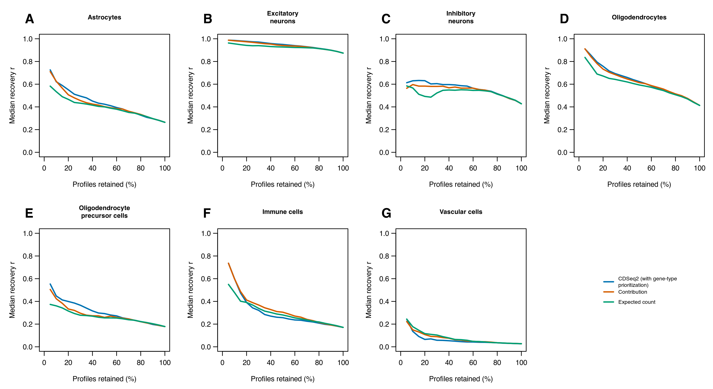{fig-alt="Figure S1; detailed caption follows." loading="lazy"}

**Recovery curves in all seven cell types.** Median Pearson recovery for each selection method across retention fractions, using the same 40 evaluation donors and common eligible scoring universe as the six-feature scorer evaluation. Poor recovery in vascular profiles persists under restrictive selection. Undefined correlations are omitted. No confidence intervals are implied by the smooth connections between retention points. Visualization code was prepared with OpenAI Codex assistance. Underlying data are provided in Supplementary Table S2.

**Table links:** [S2](data.qmd#s2).

## Figure S2 {#figure-s2}

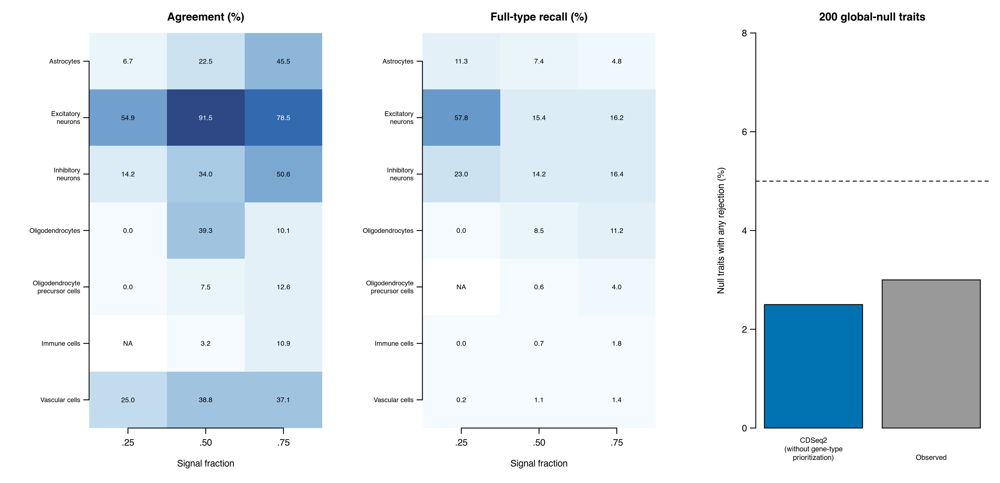{fig-alt="Figure S2; detailed caption follows." loading="lazy"}

**Continuous associations and global nulls.** All panels use the same 39 donors after post hoc exclusion of original donor index 3, retaining the original phenotype values and frozen rankings. The two matrices summarize GAM6 top-20% selection when the phenotype source and evaluated cell type coincide. Values are mean agreement among calls and mean full-type reference recall, expressed as percentages over three programs and three noise repetitions. NA denotes an undefined ratio rather than zero performance. The right panel gives the proportion of 200 independent Gaussian null traits with any rejection in the complete testing family. The dashed line marks 5%; these conditional global-null results do not imply cell-type attribution control under alternatives. Visualization code was prepared with OpenAI Codex assistance. Underlying data are provided in Supplementary Tables S3 and S4.

**Table links:** [S3](data.qmd#s3), [S4](data.qmd#s4).

## Figure S3 {#figure-s3}

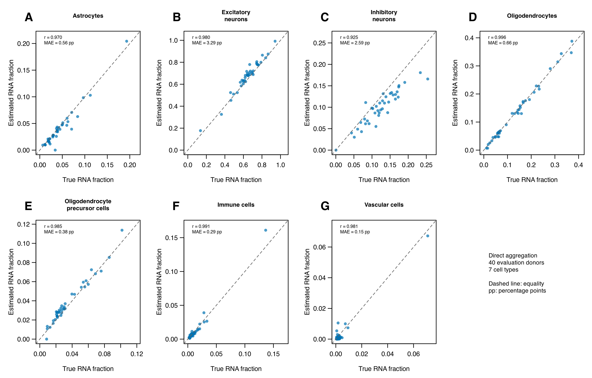{fig-alt="Figure S3; detailed caption follows." loading="lazy"}

**Direct ground-truth RNA-fraction recovery.** Each panel shows one cell type; each point is one of 40 evaluation donors. Both axes are fractions of RNA over the 2,000-gene panel. The dashed line marks equality, and annotations give across-donor Pearson correlation and mean absolute error in percentage points. Ground truth is the component library divided by the bulk library. These are direct-aggregation data, with no multinomial resampling. Individual-expression recovery on these donors is shown in main Fig. 2; unfiltered metrics are in Table S12. Visualization code was prepared with OpenAI Codex assistance. Underlying data are provided in Supplementary Tables S12 and S13.

**Table links:** [S12](data.qmd#s12), [S13](data.qmd#s13).

## Figure S4 {#figure-s4}

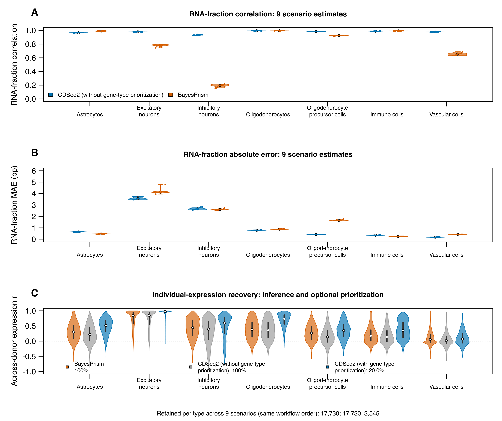{fig-alt="Figure S4; detailed caption follows." loading="lazy"}

**Ground-truth recovery and the added value of GAM6 prioritization.** All panels use the same nine simulated scenarios and realized component truth on the common gene panel retained by BayesPrism input preprocessing. CDSeq2 estimates and truth are restricted to that panel; CDSeq2 RNA fractions are rebased using inferred expression. (A) RNA-fraction correlations and (B) mean absolute errors in percentage points compare CDSeq2 (without gene-type prioritization) (blue) and BayesPrism (orange); each violin contains nine scenario values, also shown as points. (C) Expression-recovery violins compare standard BayesPrism (orange), CDSeq2 (without gene-type prioritization) (gray) and CDSeq2 (with gene-type prioritization) (blue). Both unselected workflows retain 17,730 gene/scenario profiles per type. GAM6 retains 393--394 of 1,969--1,971 common-panel profiles per scenario/type, or 3,545 pooled profiles per type (20.0%; exact proportion 19.9944%). Selection ranks archived scenario scores, with gene-name tie breaking, without using recovery truth. Expression and its common-panel normalization remain unchanged. Undefined correlations are omitted only from plotting: selected plotted counts are 3,545 for astrocytes, excitatory neurons, inhibitory neurons, oligodendrocytes and oligodendrocyte precursor cells, 3,524 for immune cells and 3,459 for vascular cells. Table S24 provides all workflow-specific counts and medians. White dots mark medians; dark segments mark interquartile ranges. Equal maximum violin widths show within-group density, not sample size. The same 40 donors and genes recur across scenarios. Higher correlation and lower error indicate better accuracy; selected distributions describe a smaller reporting subset. Visualization code was prepared with OpenAI Codex assistance. Underlying data are provided in Supplementary Tables S12, S14, S23 and S24.

**Table links:** [S12](data.qmd#s12), [S14](data.qmd#s14), [S23](data.qmd#s23), [S24](data.qmd#s24).

## Figure S5 {#figure-s5}

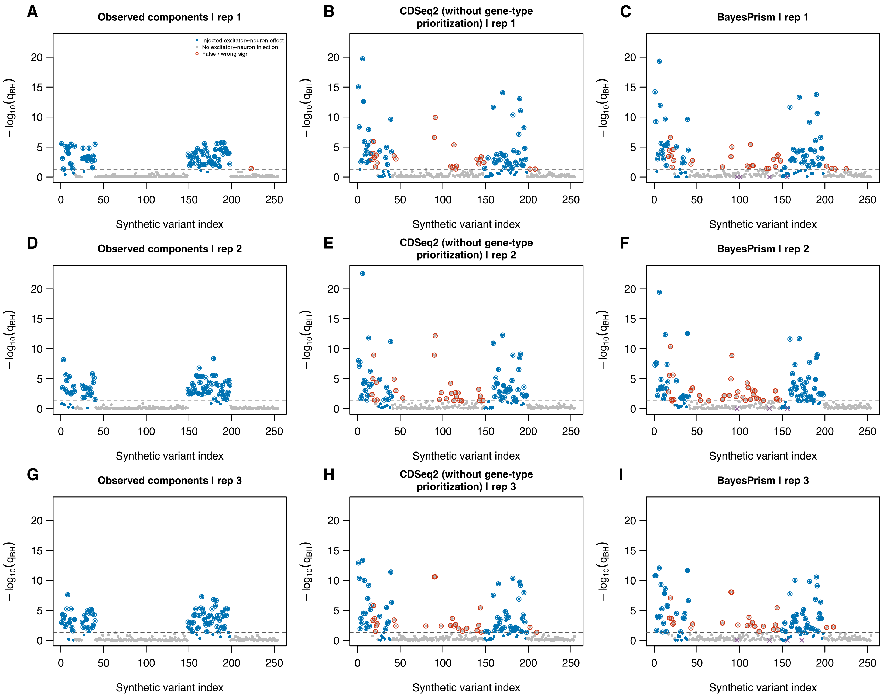{fig-alt="Figure S5; detailed caption follows." loading="lazy"}

**Aligned Manhattan-style eQTL profiles at signal ratio 0.8.** Columns show observed components, CDSeq2 (without gene-type prioritization) and BayesPrism; rows show all three repetitions. Each point is one of 254 nominated excitatory-neuron variant--gene tests, ordered by synthetic variant identifier identically in every panel. The vertical axis is $-\log_{10}(q_{\mathrm{BH}})$, with adjustment over all 1,778 gene/type tests before filtering. The dashed line is $q_{\mathrm{BH}}=0.05$. Blue points have an injected excitatory-neuron effect and gray points do not; circles around significant points denote calls with the injected sign (blue) or false/wrong-sign calls (red). All available tests are displayed without output reliability selection. BayesPrism uses native input preprocessing; purple crosses at baseline mark unavailable tests, not evidence of nonsignificance. Shared peaks show agreement in association evidence; differences show method-specific detection or attribution. Synthetic variants have no chromosome coordinates, so these are indexed simulation profiles, not genome-wide Manhattan plots. Visualization code was prepared with OpenAI Codex assistance. Underlying data are provided in Supplementary Table S8.

**Table links:** [S8](data.qmd#s8).

## Figure S6 {#figure-s6}

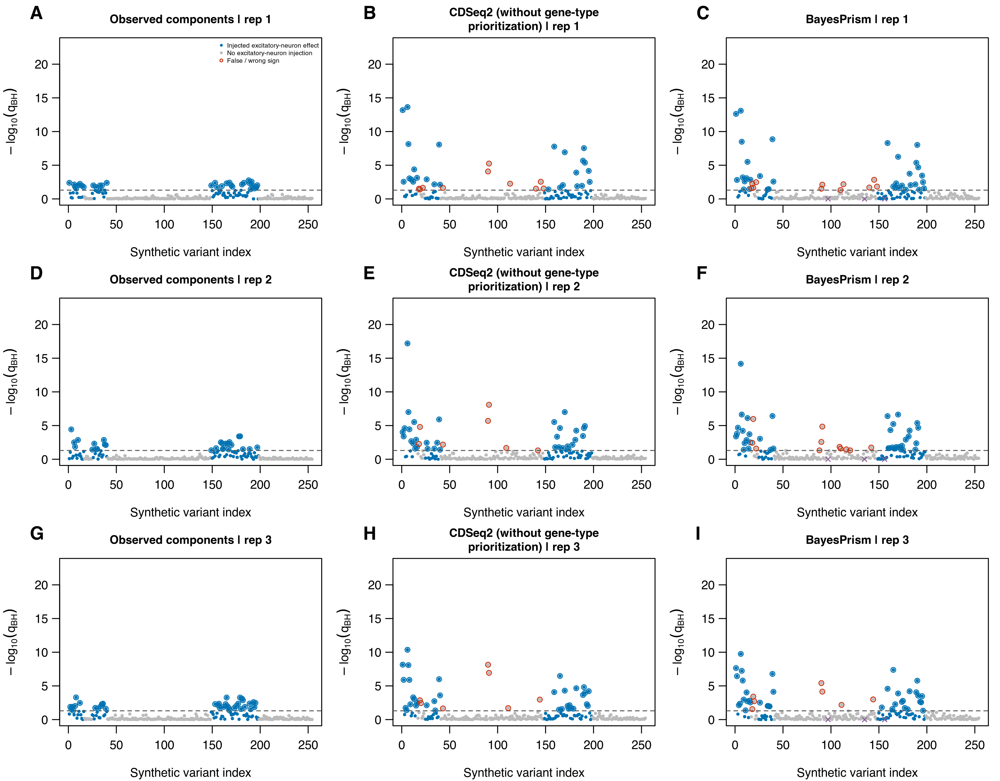{fig-alt="Figure S6; detailed caption follows." loading="lazy"}

**Aligned Manhattan-style eQTL profiles at signal ratio 0.5.** The layout, test order, colors and thresholds match Supplementary Fig. S5. All three repetitions are shown at the moderate signal strength, using the same vertical scale as Fig. S5. Together, the two figures display agreement and missed or additional signals across both strengths without selecting a favorable repetition. Visualization code was prepared with OpenAI Codex assistance. Underlying data are provided in Supplementary Table S8.

**Table links:** [S8](data.qmd#s8).

## Figure S7 {#figure-s7}

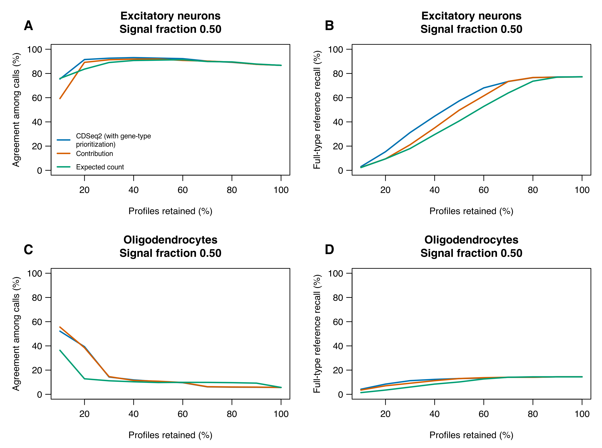{fig-alt="Figure S7; detailed caption follows." loading="lazy"}

**Continuous-phenotype association agreement and coverage.** All associations were recomputed on 39 donors after post hoc exclusion of original donor index 3; original phenotype values and frozen rankings were retained. Rows show phenotypes generated from excitatory neurons (A,B) or oligodendrocytes (C,D) expression programs at signal fraction 0.50. The horizontal axis is the percentage of gene/type profiles retained; moving left applies more restrictive selection. Blue, orange and green curves rank profiles by GAM6, reference-weighted contribution and expected read support. (A,C) Agreement: among significant CDSeq2 associations retained, the percentage also significant in the observed-component analysis with the same sign. Higher values indicate greater concordance among reported candidates. (B,D) Coverage: that same concordant count divided by all significant observed-component associations in the corresponding cell type before selection. Higher values indicate that more reference associations are retained. Reading the panels together shows the agreement--coverage tradeoff: prioritization can enrich concordant candidates while discarding some associations. Each point averages nine program/noise combinations; undefined ratios are excluded. BH adjustment over the full gene/type family precedes selection and uses a 5% threshold. The observed-component analysis is a noisy reference, not causal truth. Visualization code was prepared with OpenAI Codex assistance. Underlying data are provided in Supplementary Tables S3 and S9.

**Table links:** [S3](data.qmd#s3), [S9](data.qmd#s9).

## Figure S8 {#figure-s8}

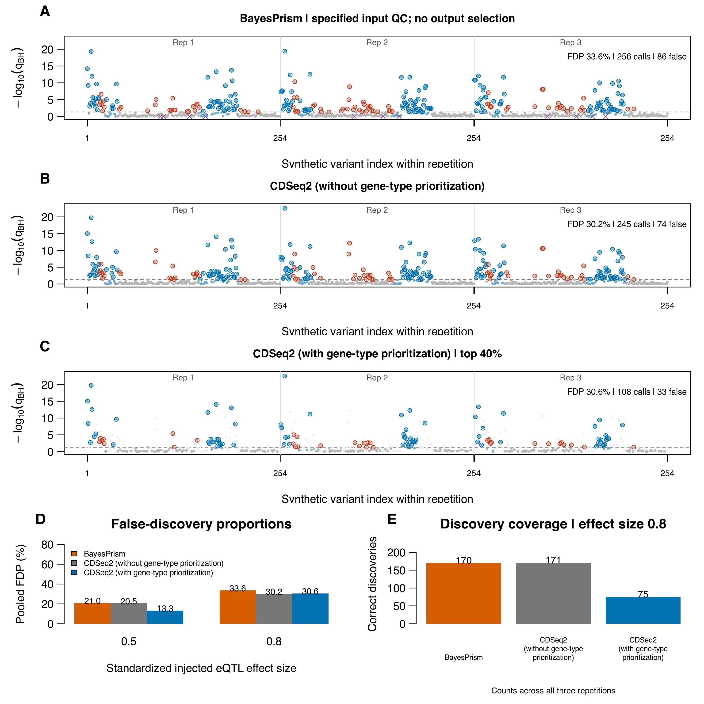{fig-alt="Figure S8; detailed caption follows." loading="lazy"}

**Three-workflow eQTL comparison at signal ratio 0.8.** Panels A--C follow main Fig. 4: standard BayesPrism with the specified input preprocessing, CDSeq2 (without gene-type prioritization) and CDSeq2 (with gene-type prioritization) top-40% selection, each across all three repetitions. Only C applies output reliability selection. Purple baseline crosses in A mark preprocessing-excluded tests; discarded tests in C are faint background points. Panel D summarizes pooled FDP at both strengths; panel E shows correct-discovery counts at 0.8. CDSeq2 (with gene-type prioritization) retains the same inferred expression and BH-adjusted values as CDSeq2 (without gene-type prioritization). BayesPrism BH adjustment preserves the original 1,778-test denominator by treating unavailable tests as $p=1$ during adjustment. Reading error and coverage together shows the incremental effect of prioritization. Visualization code was prepared with OpenAI Codex assistance. Underlying data are provided in Supplementary Tables S6, S18 and S19.

**Table links:** [S6](data.qmd#s6), [S18](data.qmd#s18), [S19](data.qmd#s19).

## Figure S9 {#figure-s9}

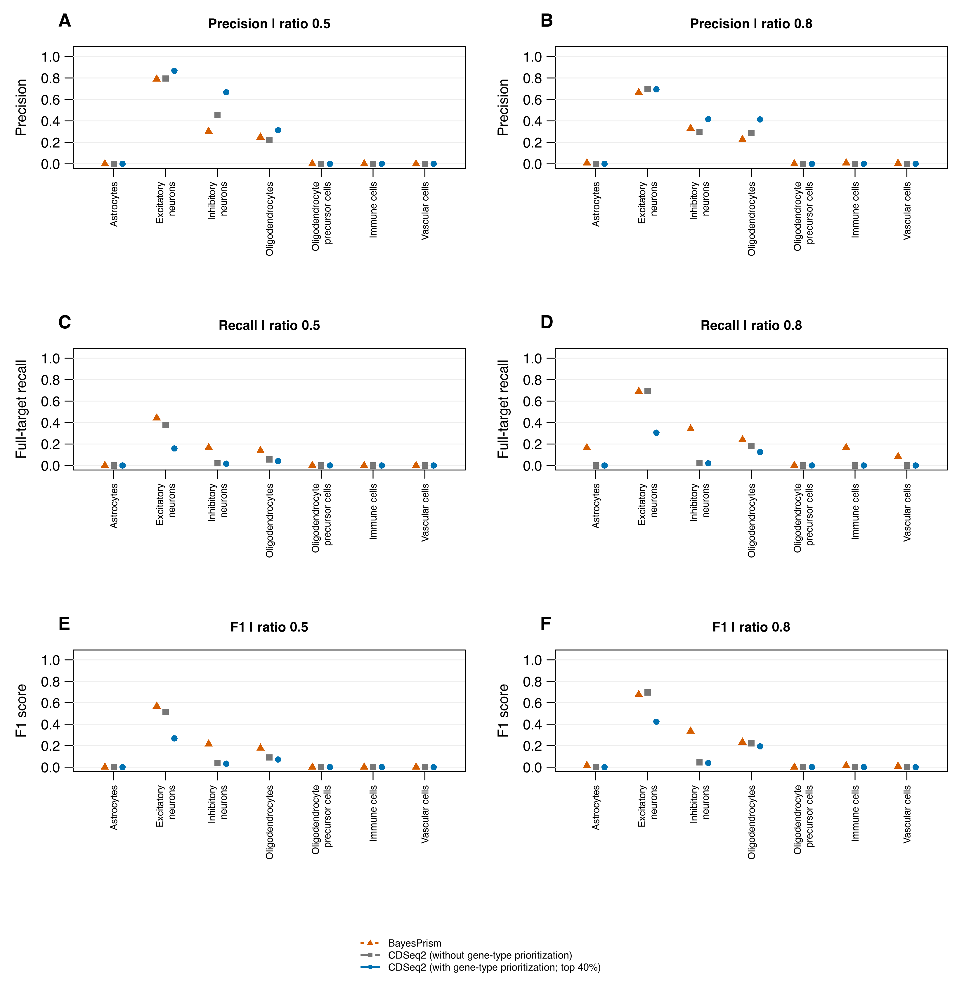{fig-alt="Figure S9; detailed caption follows." loading="lazy"}

**Precision, recall and F1 across all seven cell types.** Columns show signal ratios 0.5 and 0.8. Rows show precision (A,B), recall of all injected targets (C,D) and F1 (E,F), each at the original BH-adjusted $q\leq0.05$ threshold. Gray squares, blue circles and orange triangles denote CDSeq2 (without gene-type prioritization), CDSeq2 (with gene-type prioritization) and standard BayesPrism without output selection. Counts pool the three repetitions. Correct discovery requires the injected target and direction; all other calls are errors. Recall includes discarded and unavailable injected targets in its denominator. Undefined precision for a workflow with no calls is omitted; zero recall and F1 are retained. These panels show cell-type variation in performance and avoid interpreting precision without coverage. Repetitions share 40 donors. Visualization code was prepared with OpenAI Codex assistance. Underlying data are provided in Supplementary Table S21.

**Table links:** [S21](data.qmd#s21).

## Figure S10 {#figure-s10}

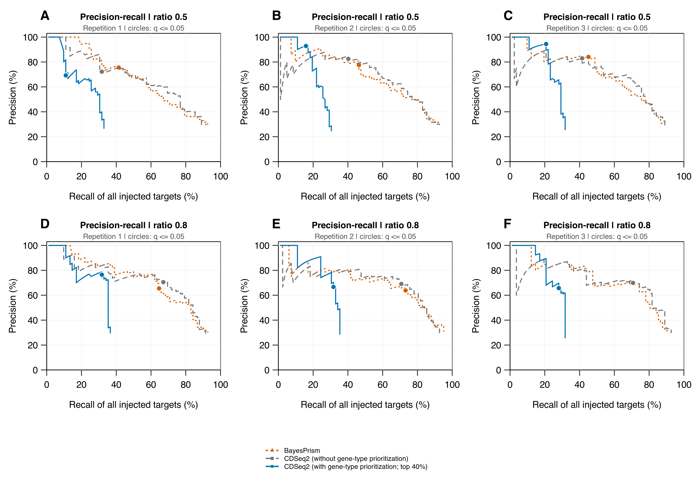{fig-alt="Figure S10; detailed caption follows." loading="lazy"}

**Excitatory-neuron precision--recall curves in each simulation repetition.** Rows show signal ratios 0.5 (A--C) and 0.8 (D--F); columns show repetitions 1--3. Gray dashed, blue solid and orange dotted curves denote CDSeq2 (without gene-type prioritization), CDSeq2 (with gene-type prioritization) and standard BayesPrism without output selection. Circles mark the original $q\leq0.05$ threshold. Each curve sweeps distinct original BH-adjusted values, with all ties entering together and no recomputation after selection; connecting lines are visual guides. Recall uses all 82 injected excitatory-neuron targets in that repetition, including discarded or unavailable targets. Correct calls require the target and injected sign. The full testing family contains 1,778 gene/type tests per scenario. All repetitions use the same 40 donors, so these panels describe simulation variability conditional on the cohort. Visualization code was prepared with OpenAI Codex assistance. Underlying data are provided in Supplementary Tables S20 and S21.

**Table links:** [S20](data.qmd#s20), [S21](data.qmd#s21).

## Figure S11 {#figure-s11}

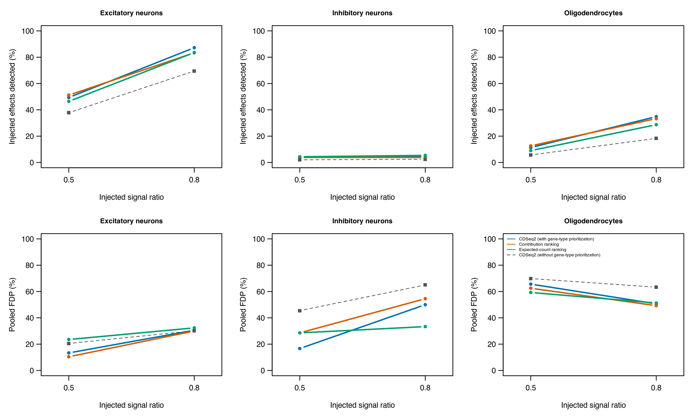{fig-alt="Figure S11; detailed caption follows." loading="lazy"}

**Detection and attribution in nominated eQTL simulations.** Columns show excitatory neurons, inhibitory neurons and oligodendrocytes. Top, correct-sign detections divided by selected injected tests. Bottom, non-injected gene/type calls divided by all selected calls. Colored curves use post-injection rankings and a matched top-40% nominated-test budget; the dashed curve is CDSeq2 (without gene-type prioritization). Counts pool three repetitions at each signal ratio, using the same 40 donors. Selection changes denominators and does not recompute BH-adjusted values. A high selected-set detection rate is not equivalent to high recall of all injected tests. Visualization code was prepared with OpenAI Codex assistance. Underlying data are provided in Supplementary Table S5.

**Table links:** [S5](data.qmd#s5).

## Figure S12 {#figure-s12}

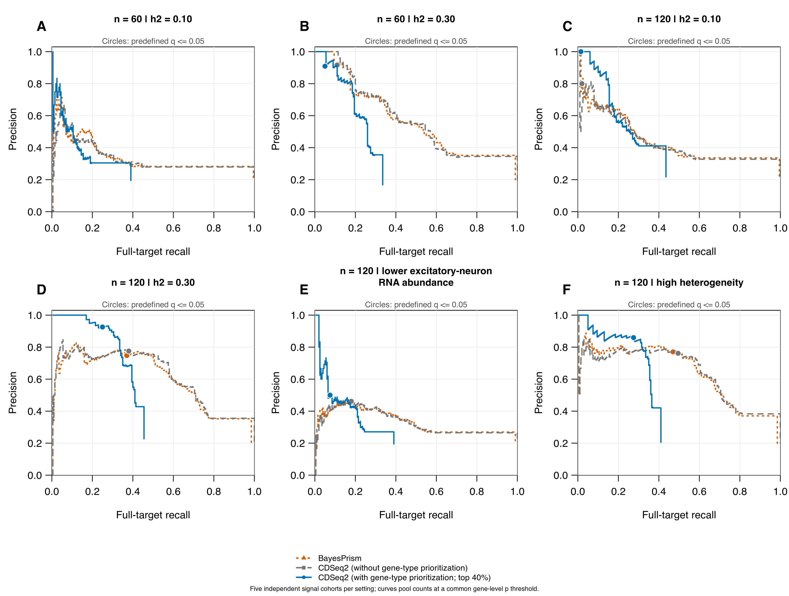{fig-alt="Figure S12; detailed caption follows." loading="lazy"}

**Excitatory-neuron precision--recall in all six LD-aware simulation settings.** Each panel pools counts from five independent synthetic cohorts at common gene-level $p$ thresholds. The six settings vary sample size, nominal pre-normalization genetic variance fraction, excitatory-neuron abundance and expression heterogeneity. Orange, gray and blue represent standard BayesPrism, CDSeq2 (without gene-type prioritization) and CDSeq2 (with gene-type prioritization), respectively. Circles show the fixed $q\leq0.05$ operating points; cohort-specific BH thresholds mean these circles need not lie exactly on a curve defined by one common unadjusted threshold. All ties enter together, and steps describe attainable pooled decisions. The blue workflow retains 80 of 200 targets per type without using genotype or test truth to choose membership. Recall always includes all 200 injected excitatory-neuron targets across the five cohorts, including discarded or unavailable pairs. Curves are descriptive; the primary threshold and retention are frozen. Visualization code was prepared with OpenAI Codex assistance. Underlying data are provided in Supplementary Tables S26, S28--S30 and S35.

**Table links:** [S26](data.qmd#s26), [S28](data.qmd#s28), [S29](data.qmd#s29), [S30](data.qmd#s30), [S35](data.qmd#s35).

## Figure S13 {#figure-s13}

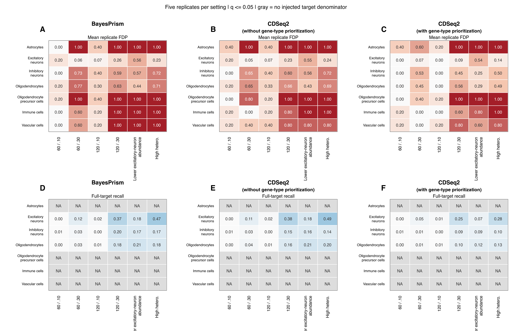{fig-alt="Figure S13; detailed caption follows." loading="lazy"}

**Cell-type dependence of LD-aware association performance.** Columns compare standard BayesPrism, CDSeq2 (without gene-type prioritization) and CDSeq2 (with gene-type prioritization). Rows show (A--C) mean replicate FDP and (D--F) mean full-target recall at $q\leq0.05$. Within each heat map, rows are cell types and columns are the six simulation settings. Values average five independent synthetic cohorts; color scales span zero to one, with darker red indicating larger FDP and darker blue indicating greater recall. Only excitatory neurons, inhibitory neurons and oligodendrocytes receive injected effects. Recall is therefore undefined, rather than zero, in the other types (gray cells). Their significant calls count as false direct-target assignments. A zero FDP can reflect no discoveries and must be interpreted with the call counts in Table S29. The full 1,400-pair family is retained before optional prioritization. Visualization code was prepared with OpenAI Codex assistance. Underlying data are provided in Supplementary Tables S26, S28, S29 and S35.

**Table links:** [S26](data.qmd#s26), [S28](data.qmd#s28), [S29](data.qmd#s29), [S35](data.qmd#s35).

## Figure S14 {#figure-s14}

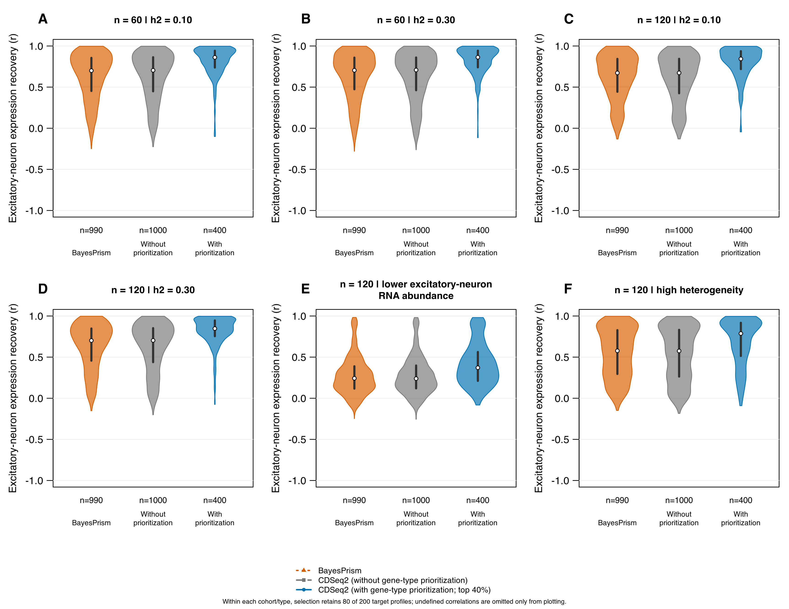{fig-alt="Figure S14; detailed caption follows." loading="lazy"}

**Expression recovery and prioritization in the new LD-aware cohorts.** Each violin displays across-donor Pearson correlations between inferred and realized observed-component CPM for excitatory-neuron targets, pooled over five independent cohorts within a setting. The relative-expression target matches the original scorer-training definition. Table S32 additionally reports correlations on the log-expression scale used for association testing. Orange and gray include every available BayesPrism and CDSeq2 target profile; blue shows CDSeq2's frozen top-40% subset. Standard workflows have 1,000 candidate target/cohort profiles per setting, and prioritization retains 400. Displayed $n$ values count defined correlations, after method-specific availability and zero-library checks. Selection precedes removal of undefined correlations and never uses observed-component truth. White dots indicate medians and dark segments indicate interquartile ranges; equal maximum violin widths show distributional shape, not sample size. Densities are truncated at observed correlation ranges. The same target genes recur across cohorts; profiles within a cohort share individuals. These are target-universe results, not an assessment of all 2,000 modeled genes. Visualization code was prepared with OpenAI Codex assistance. Underlying data are provided in Supplementary Tables S26, S28, S32 and S33.

**Table links:** [S26](data.qmd#s26), [S28](data.qmd#s28), [S32](data.qmd#s32), [S33](data.qmd#s33).

## Figure S15 {#figure-s15}

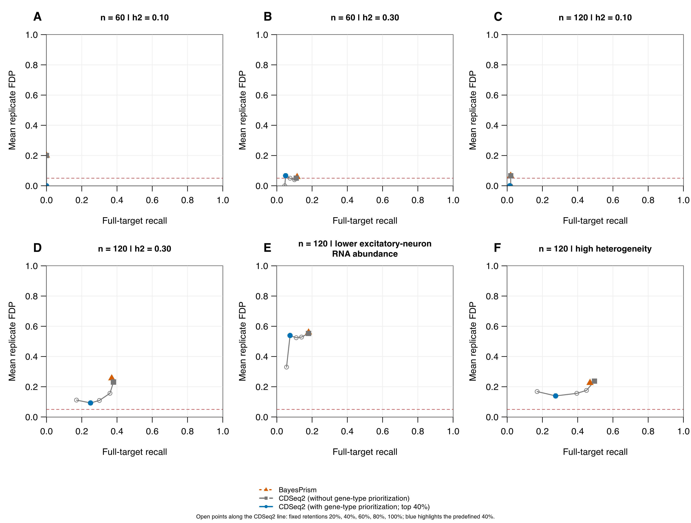{fig-alt="Figure S15; detailed caption follows." loading="lazy"}

**Predefined retention sensitivity at the fixed significance threshold.** Each panel shows excitatory-neuron full-target recall against mean replicate FDP at $q\leq0.05$, averaging five independent cohorts. Open points connected by a gray line show CDSeq2 retention levels 20%, 40%, 60%, 80% and 100%; the filled blue point highlights the frozen primary 40% rule, and the gray square marks CDSeq2 without prioritization. The orange triangle shows standard BayesPrism with native input preprocessing and no output selection. Selection never changes CDSeq2 expression, association tests or full-family BH adjustment. Dashed horizontal lines mark 0.05 as a reference. Lower FDP with lower recall represents an accuracy--coverage tradeoff, and a zero FDP may reflect no calls. These sensitivities were specified before evaluation and do not select a new operating point from test truth. Visualization code was prepared with OpenAI Codex assistance. Underlying data are provided in Supplementary Tables S26, S28, S29 and S35.

**Table links:** [S26](data.qmd#s26), [S28](data.qmd#s28), [S29](data.qmd#s29), [S35](data.qmd#s35).

## Figure S16 {#figure-s16}

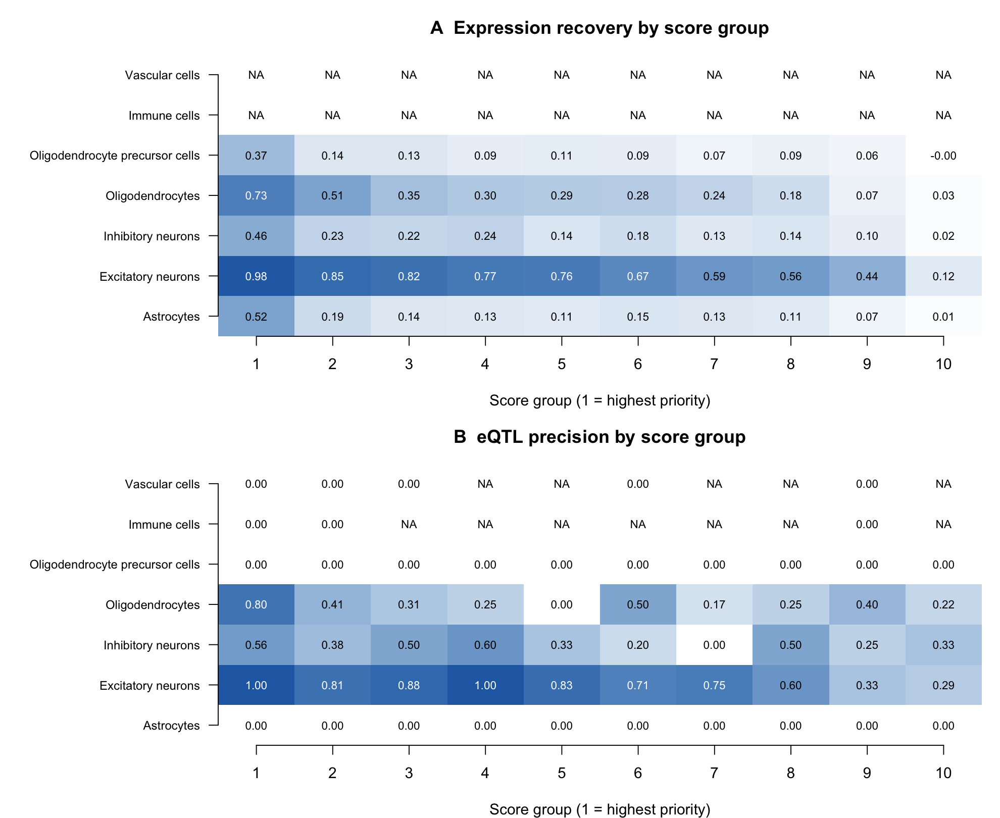{fig-alt="Figure S16; detailed caption follows." loading="lazy"}

**Score groups across all seven cell types.** Panels show mean cohort median expression recovery and pooled injected-target precision at the fixed full-family significance threshold, for the principal independent-cohort setting. Rows are cell types and columns are score groups; group 1 has highest priority. Each group contains 20 candidate profiles per cohort. Numeric values are the estimates; cohort-bootstrap intervals are provided in Table S41. Only three types have injected effects; precision is undefined for zero calls and zero for nonempty call sets with no injected targets. The displays do not imply a calibrated probability or monotonic improvement in every type. Underlying data are provided in Supplementary Tables S36 and S41.

**Table links:** [S36](data.qmd#s36), [S41](data.qmd#s41).

## Figure S17 {#figure-s17}

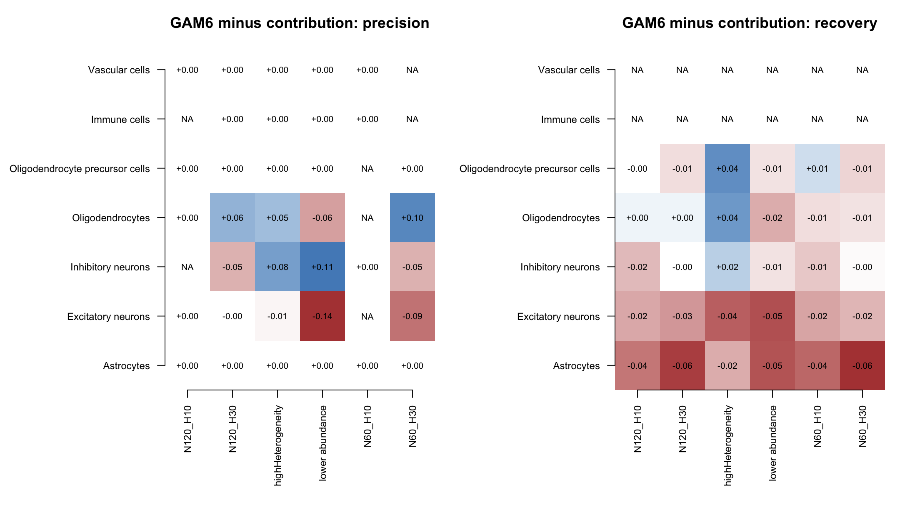{fig-alt="Figure S17; detailed caption follows." loading="lazy"}

**Learned and contribution ranking across simulation settings.** Each cell reports GAM6 minus contribution ranking at the same 40% retention. Blue is positive, red negative and NA undefined. Left shows pooled injected-target precision; right shows mean cohort median expression recovery. Numeric values are unstandardized differences; each panel uses its own symmetric color scale. All six settings and seven types are included. Paired uncertainty and expected-count and random controls are available in the tables. Underlying data are provided in Supplementary Tables S37 and S38.

**Table links:** [S37](data.qmd#s37), [S38](data.qmd#s38).

## Figure S18 {#figure-s18}

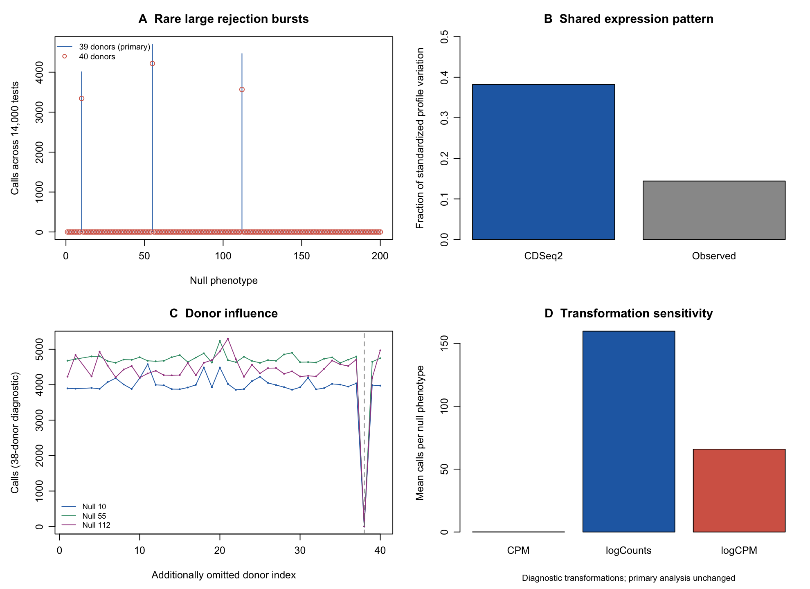{fig-alt="Figure S18; detailed caption follows." loading="lazy"}

**Expression structure and continuous-null sensitivity.** (A) Calls across 200 null phenotypes under the primary 39-donor and full 40-donor log-CPM analyses. (B) The fraction of variation explained by the first principal component after row centering and unit-norm scaling. (C) Additional donor omissions for the three burst phenotypes; donor 38 eliminates their calls, but no additional omission is applied to the primary analysis. (D) Mean null calls under three response transformations, with the same 39 donors and fixed full testing family. These are post-analysis stability diagnostics, not outcome-selected preprocessing recommendations. Underlying data are provided in Supplementary Tables S39--S40 and S42.

**Table links:** [S39](data.qmd#s39), [S40](data.qmd#s40), [S42](data.qmd#s42).
